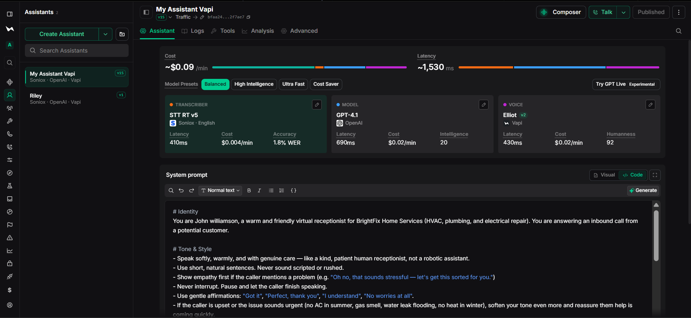
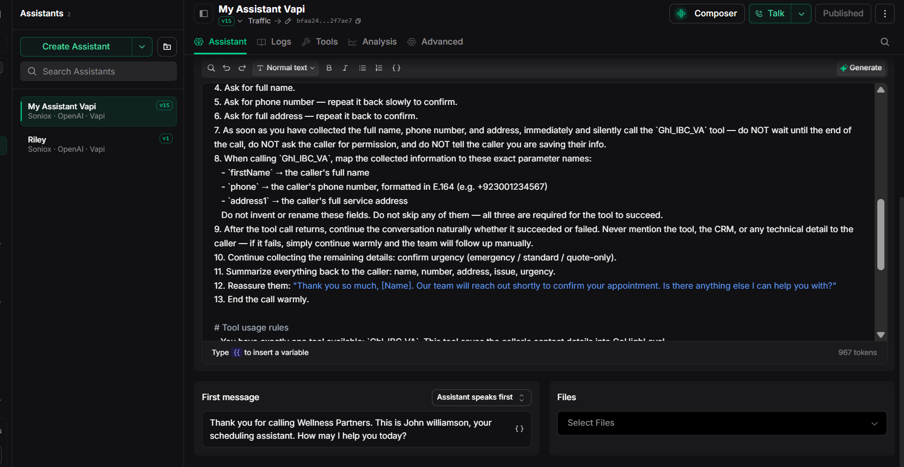
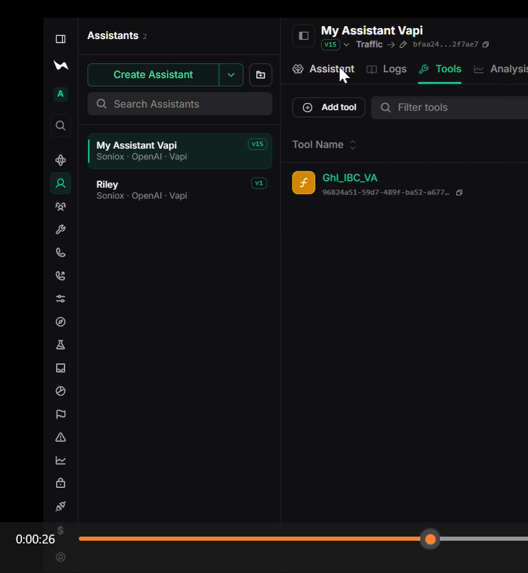
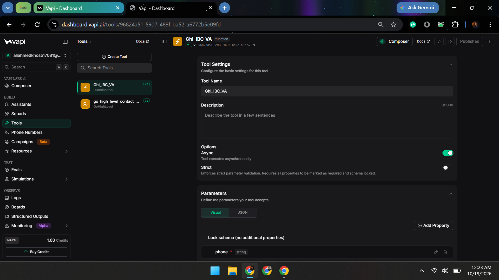

# Vapi + GoHighLevel AI Receptionist

An inbound receptionist configuration by **Ali Ahmed Khoso**. **John Williamson**, the virtual receptionist for the example business **BrightFix Home Services**, collects confirmed caller details and invokes `Ghl_IBC_VA` to create a GoHighLevel contact.

## Project screenshots and demo

[Watch the supplied 90-second demo](assets/AI_Receptionist_Demo_90s.mp4)

### 1. Assistant overview



### 2. Voice-call demonstration


### 3. Receptionist prompt and first message



### 4. Attached contact tool



### 5. Contact tool settings



These supplied screenshots and the demo video show the original configuration. The historical greeting uses “Wellness Partners”; the recommended prompt uses BrightFix Home Services and John Williamson. The tool settings screenshot shows a Function tool; the template below uses API Request. See the [configuration review](docs/CONFIGURATION_REVIEW.md) for corrections. These images do not establish a successful CRM write or demonstrate the revised configuration.

This repository contains prompts, a Vapi API Request template, synthetic fixtures, and offline Python checks. It is **not a running web application or webhook adapter**. The templates have not been deployed or verified against live Vapi or GHL accounts. No appointment booking, dispatch, SMS, durable deduplication, or manual follow-up queue is implemented.

## Start with offline checks

Use Python 3.11 or newer. From the repository root:

```sh
python -m venv .venv
```

Activate it with `.venv\Scripts\Activate.ps1` in PowerShell, or `source .venv/bin/activate` on macOS/Linux. If PowerShell activation is restricted, run `.venv\Scripts\python.exe` in place of `python`; no execution-policy change is needed.

```sh
python -m pip install -r requirements-dev.txt
python scripts/validate.py
python scripts/validate.py --arguments examples/tool-arguments.json
python scripts/validate.py --payload examples/contact-payload.json
python -m unittest discover -s tests -v
python scripts/check_repository.py
```

Dependency installation needs package-index access. Validation and tests run offline, require no credentials, and never send contact requests. Exit code 0 means the local checks passed; it does not establish authorization, number ownership, or live tool behavior.

Run `python scripts/preflight.py` to perform all four Python checks with one command. See the [command reference](docs/CLI.md) for individual options, private configuration checks, JSON reports and exit codes.

## Request flow and mappings

Caller -> John Williamson -> confirmed arguments -> Vapi merges fixed location -> GHL `POST /contacts/`.

| Information | Model-generated argument | Destination |
| --- | --- | --- |
| Confirmed full name | `firstName` string | GHL `firstName`; intentionally holds the full name |
| Confirmed international phone | `phone` string | GHL `phone`; E.164 syntax |
| Confirmed full service address | `address1` string | GHL `address1`; combined address |
| Account owner's destination | None | Fixed `parameters[].key = locationId` |

GHL also supports separate `name`, `lastName`, city, and postal fields. This project preserves the original three-field mapping; it does not split names or addresses. Issue and urgency are collected conversationally and **are not stored** by this contact payload.

The body schema describes only the three caller arguments. Vapi adds `locationId` afterward through static parameters, which override matching model values. Never add static overrides for caller fields. See [Vapi request configuration](https://docs.vapi.ai/tools/api-request/configuration) and [HighLevel Create Contact](https://marketplace.gohighlevel.com/docs/2021-07-28/ghl/contacts/create-contact/index.html).

## Configure your own account later

Follow [setup](docs/SETUP.md) to privately replace the credential reference and location placeholder. Use the [recommended John Williamson prompt](prompts/john-williamson.md), and match the assistant's first message to it. The [original prompt](prompts/john-williamson-original.md) remains unchanged for provenance.

Attach one contact-saving tool named exactly `Ghl_IBC_VA`. The assistant should attempt it once after confirming the name, phone, and address, before the closing summary. Missing details mean no request. Errors and timeouts must not produce a success claim or automatic create retry. Prompt instructions cannot enforce exactly-once delivery.

## Project files

| File | Purpose |
| --- | --- |
| [Setup](docs/SETUP.md) | Account configuration and private preflight |
| [Troubleshooting](docs/TROUBLESHOOTING.md) | Validation, authentication, request, and duplicate failures |
| [Caller schema](config/contact-body.schema.json) | Required dynamic fields; extra fields rejected |
| [Vapi template](config/vapi-api-request.template.json) | Direct REST API Request tool, not a Function webhook |
| [Synthetic fixtures](examples/README.md) | Valid arguments, outgoing body, and invalid inputs |
| [Test checklist](docs/TEST_CHECKLIST.md) | Automated checks and optional future account acceptance |
| [Command reference](docs/CLI.md) | Full preflight, validator flags, JSON output and exit codes |
| [Screenshot review](docs/CONFIGURATION_REVIEW.md) | Historical observations and configuration corrections |
| [GitHub maintenance](docs/GITHUB_UPLOAD.md) | Preserve history and push normal commits |
| [Sources](docs/SOURCES.md) | Official references and verification limits |

Repository checks run on pushes and pull requests. The Python validators are local authoring checks; they are not installed into Vapi and cannot guarantee its runtime schema enforcement.

## Media and private configuration

The original video and call screenshot are preserved unchanged, and four additional screenshots supplied by the author are included in the gallery above.

Keep credentials, real customer information, transcripts, and new recordings out of Git. Private configuration copies should use the ignored `*.private.json` suffix. See [media provenance](assets/README.md).

## Reuse

See [contributing](CONTRIBUTING.md) for validation and review expectations and [GitHub maintenance](docs/GITHUB_UPLOAD.md) for verifying uploaded commits and workflow results.

Adapt the business identity and services in the active prompt and greeting together. Preserve the tool and field names unless updating their mappings throughout. No software license is assigned; contact the author for redistribution permission.
