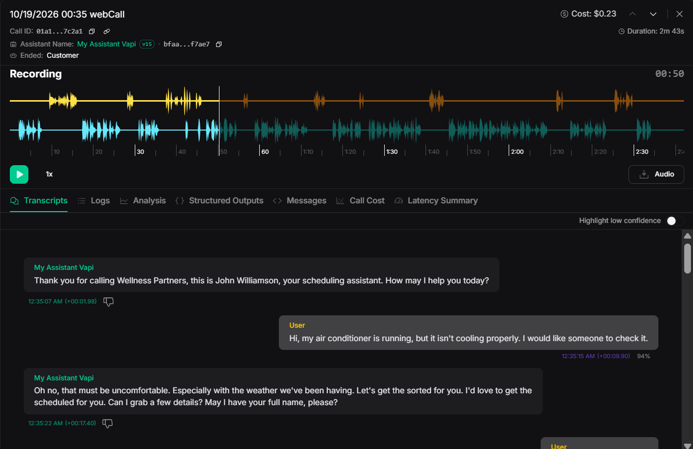

# Vapi + GoHighLevel AI Receptionist

An inbound voice receptionist project by **Ali Ahmed Khoso**, using Vapi to collect caller details and send a contact request to GoHighLevel.

John Williamson is the receptionist persona. BrightFix Home Services is the example business in the supplied prompt. Replace the business name when adapting the project.

## What this project covers

- Friendly intake for HVAC, plumbing, and electrical service requests.
- One question at a time, with phone and address confirmation.
- Mid-call contact creation through `Ghl_IBC_VA` once all three required details are available.
- Conversation-level collection of the issue and urgency.
- A repeatable test checklist.

**Status:** This is a configuration and documentation repository based on the author's prompt and screenshots. The supplied screenshots were reviewed; no live Vapi call or GoHighLevel write was performed while preparing this package. The JSON files are templates, not an export of the author's live assistant. There is no local application to run.

## Flow

The caller speaks to John Williamson in Vapi. John Williamson confirms the name, phone, and address, then invokes `Ghl_IBC_VA`. The configured request creates a GoHighLevel contact. John Williamson continues with urgency and a summary; the human team handles follow-up.

## Field mapping

| Caller information | Tool field | Type | Source |
| --- | --- | --- | --- |
| Full name | `firstName` | String | Caller |
| Confirmed international phone | `phone` | String | Caller |
| Full service address | `address1` | String | Caller |
| GHL sub-account/location | `locationId` | String | Fixed private configuration |

The full name intentionally goes into `firstName` to preserve the author's exact mapping. This means GHL's first-name field contains the full name. Issue and urgency are **not** in this contact payload; storing them requires an additional mapping or workflow.

## Files

| File | Purpose |
| --- | --- |
| [Original prompt](prompts/john-williamson-original.md) | Author-supplied assistant instructions |
| [Setup guide](docs/SETUP.md) | How to recreate and use the project |
| [Screenshot review](docs/CONFIGURATION_REVIEW.md) | Corrections and unverified parts |
| [Tool body schema](config/contact-body.schema.json) | Three required caller fields |
| [API Request template](config/vapi-api-request.template.json) | Proposed direct-API implementation |
| [Example contact payload](examples/contact-payload.json) | Synthetic data showing the outgoing body |
| [Test checklist](docs/TEST_CHECKLIST.md) | Live checks to run in your own account |
| [GitHub upload guide](docs/GITHUB_UPLOAD.md) | Create and upload the repository |
| [Sources](docs/SOURCES.md) | Official technical references |

## Quick start

1. Read the screenshot review before copying the current tool settings.
2. Configure your own GHL credential and location ID using the setup guide.
3. Create the tool and attach it to your Vapi assistant.
4. Paste the original prompt. Review the suggested wording adjustments in the setup guide.
5. Test with synthetic details and inspect both the Vapi tool result and the GHL contact.
6. Record a demonstration showing the real outcome from your test.

## Scope and limitations

This setup captures contact details. It does not book a calendar appointment, dispatch a technician, send an SMS, or implement a manual fallback queue. A prompt instruction to call a tool exactly once is an intended behavior, not an enforced delivery guarantee. Verify call logs; production duplicate protection requires implementation beyond the prompt.

The fifth screenshot shows a separate native GHL contact tool. Do not attach both contact-creation tools to this demo. The supplied prompt expects the exact name `Ghl_IBC_VA`.

## Reuse

Change the business identity, supported services, greeting, and contact credentials for your own business. Keep the three field names aligned between the prompt and schema. The original prompt is preserved separately from configuration corrections. No software license is assigned in this package; contact the author for reuse permission before redistribution.

## Demo video

[Watch the 90-second demo](assets/AI_Receptionist_Demo_90s.mp4)

The video is included in the assets folder. To display an embedded player on GitHub, drag this MP4 into the README editing box and commit the generated attachment link.

## Call demonstration screenshot

Screenshot supplied by the author showing a web call and its opening transcript. The recorded greeting uses “Wellness Partners”; the project prompt uses “BrightFix Home Services”. This image does not show the CRM result.
